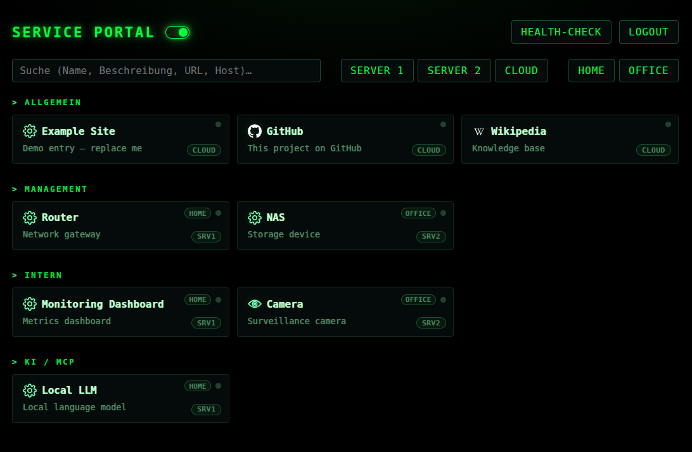

# Personal Portal Page

A small self-hosted landing page for the services running on your home/office network. Renders configurable service cards, with category sections, host/location filters, search, on-demand health checks, and a single-password gate. Matrix-green theme.



## Features

- **YAML-driven configuration** — services, hosts, locations, title all in `systems.yaml`
- **Categories**: General (always visible), Management, Internal, AI/MCP — last three only in "Admin" mode (toggle persists in `localStorage`)
- **Filter chips** for hosts, locations, and health status (single-select, click again to clear)
- **Free-text search** over name, description, URL, host
- **On-demand health checks** — parallel HTTP probes with timeout and self-signed-cert support, results visualized as a status dot per card
- **Single-password auth** — HTTP-only, HMAC-signed session cookie (30 day TTL), via SvelteKit hooks
- **Theme-adaptive favicon** that follows the browser's `prefers-color-scheme`
- **Hot-reload of `systems.yaml`** — mtime-cached, no rebuild needed
- **Optional health-check toggle** — set `healthCheck: false` in `systems.yaml` to hide the button entirely
- **Optional AI chat** (off by default) — ask in plain language and get a service opened for you; works with any OpenAI-compatible endpoint (Ollama, LM Studio, …), switchable at runtime

## Tech stack

SvelteKit 2 / Svelte 5, TypeScript, `@sveltejs/adapter-node`, `js-yaml`, `undici` for the probes.

## Quick start

```bash
cp .env.example .env       # set PORTAL_PASSWORD + PORTAL_SECRET (≥ 32 chars)
npm install
npm run dev                # http://localhost:1234
```

## Production build

```bash
npm run build
PORTAL_PASSWORD=… PORTAL_SECRET=… ORIGIN=http://your.host:1234 node build
```

The `ORIGIN` env var must match the URL the browser sees — otherwise SvelteKit's CSRF and the session cookie's `Secure` flag misbehave on plain HTTP.

## Configuration

Edit `systems.yaml`:

```yaml
title: My Portal
healthCheck: true            # optional, default true

hosts:
  myhost: { name: My Host, shortName: MyHost }
  # optional: hidden: true  → host excluded from filter chips

locations:
  home: { name: Home, shortName: Home }

services:
  - id: example
    name: Example
    host: myhost
    location: home              # optional, drives badge + filter
    url: https://example.com
    category: general           # general | management | intern | ai
    icon: gear.svg              # optional, file in static/icons/
    description: Demo entry
    disabled: false             # optional, hide entry entirely
    healthcheck:
      url: https://example.com  # falls back to `url` when omitted
      insecure: true            # optional, skip TLS verification
```

### Icons

Drop SVG/PNG/WebP files into `static/icons/` and reference them by filename. Two generic icons ship out of the box: `gear.svg` (line-art cog) and `camera.svg` (CCTV camera). For service-specific logos, [dashboardicons.com](https://dashboardicons.com/icons) is a good source.

### Auth gate

The `hooks.server.ts` redirects every unauthenticated request to `/login`. The `PUBLIC_PATHS` set lists the few paths that bypass the gate (favicon, login). The session cookie is signed with HMAC-SHA256 against `PORTAL_SECRET`.

### AI chat (optional, off by default)

Adds a prompt above the first category. It answers general questions and can open a
service for you. Enable it with an `ai:` block in `systems.yaml`:

```yaml
ai:
  enabled: true
  excludeCategories: [intern]   # categories the model must not see
  maxTokens: 512
  defaultBackend: local
  backends:
    - id: local
      label: Local
      url: http://127.0.0.1:11434/v1      # Ollama
      model: qwen3:4b-instruct            # required for Ollama
    - id: workstation
      label: Workstation
      url: http://192.168.1.20:1234/v1    # LM Studio
      # no model: LM Studio uses whatever is currently loaded
```

Any OpenAI-compatible endpoint works — the server talks `/chat/completions` with
`response_format: json_schema` and streams the reply to the browser. With more than
one backend a selector appears next to the input.

Two things worth knowing:

- The **model never sees URLs.** It returns a service `id`, which the server validates
  against `systems.yaml` before the browser opens the link — a hallucinated id opens
  nothing. Services in `excludeCategories` are invisible to the model and cannot be opened.
- The service list is injected into the system prompt and sits at its start, so
  llama.cpp's prompt cache keeps it warm. On CPU-only inference, budget for a slow
  first request and set a generous `OLLAMA_KEEP_ALIVE` — otherwise every request after
  an idle period pays the full prompt-processing cost again.

The chat sits behind the same auth gate as the rest of the portal.

## Deployment

The project is small enough that a single `node build` behind a reverse proxy is sufficient. A minimal `systemd --user` unit:

```ini
[Unit]
Description=Personal Portal Page
After=network.target

[Service]
Type=simple
WorkingDirectory=%h/Projects/personal-portal-page
EnvironmentFile=%h/Projects/personal-portal-page/.env
Environment=HOST=0.0.0.0
Environment=PORT=1234
Environment=ORIGIN=http://your.host:1234
ExecStart=/usr/bin/node build
Restart=on-failure

[Install]
WantedBy=default.target
```

Don't forget `loginctl enable-linger USER` if you want the service to survive logout/reboots.

## License

MIT — see [LICENSE](LICENSE).
